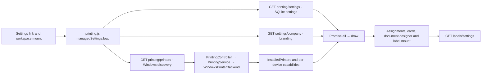

# Printer Settings performance analysis

## Confirmed request path

The exact frontend gate is `frontend/js/modules/printing.js:419`. The three requests start concurrently. Headings and a loading card paint before they settle; saved profiles, assignment controls and both designer entry points wait for the group. This is a logical dependency in the browser. The C# backend does synchronous driver work inside Task.Run on a worker, and the Web API awaits it. There is no evidence that WebView2's or WinForms' UI thread is synchronously blocked. `PrintingService.SettingsAsync` reads persisted configuration independently. Existing assignment and template data can render before discovery; server save may still validate relevant changed device selections.

`src/AlKhayal.Api/Controllers/PrintingController.cs:29` authorizes the read then awaits `PrintingService.PrintersAsync` (`:24` in the service), which forwards to `src/AlKhayal.Printing/WindowsPrinterBackend.cs:21`. It uses System.Drawing.Printing.PrinterSettings.InstalledPrinters, constructs per-device PrinterSettings, queries DeviceCapabilities bounds, default and active paper, resolution, printable area, landscape and hard margins, OpenPrinter/GetPrinter status, and PaperSizes. ActivePaper itself looks at driver paper metadata. No WMI or PowerShell is involved in the application request. Explicit EnumPrinters is not called by this source. The Windows implementation underneath System.Drawing is outside this source check. Custom DEVMODE validation belongs to later validation/output paths. Discovery serially collects all device capabilities before sending the list.

## Measurements

Windows 11 Pro build 26300, PowerShell on .NET Framework, installed Microsoft Print to PDF only, default and available, 84 paper definitions. Read-only invocation of the existing Release net48 test-output assembly with no print renderer required for discovery. Existing binary, no fresh rebuild. The first call means first in this process after a names-only read, with the spooler and drivers left running.

| Milliseconds | Individual trials | Median | Slowest |
| --- | --- | ---: | ---: |
| Installed names only | 11.42, 1.25, 1.18, 0.85, 1.09 | 1.18 | 11.42 |
| Full Windows backend | 2372.13, 1299.61, 1270.36, 1208.21, 1431.72 | 1299.61 | 2372.13 |
| Full backend warm trials 2–5 | 1299.61, 1270.36, 1208.21, 1431.72 | 1284.99 | 1431.72 |
| Edge controls visible, fast fixture | 71, 80, 108, 97, 76 | 80 | 108 |
| Edge controls visible, 1250 ms fixture | 1384, 1386, 1393, 1397, 1404 | 1393 | 1404 |
| Edge navigation click completion, fast fixture | 39, 57, 54, 58, 49 | 54 | 58 |
| Edge navigation click completion, 1250 ms fixture | 46, 40, 43, 54, 58 | 46 | 58 |

Edge 158.0.4370.33, Light, 1366×768, current frontend, intercepted fixture traffic. Click completion is a proxy for route dispatch, not a paint measurement. Saved-settings and company timestamps in the JSON represent interception/response dispatch, not real SQLite or HTTP round-trip. Controls-visible time includes automation observation overhead. There was exactly one discovery request on each ordinary mount in this matrix. No exceptions occurred in the five Windows trials.

A second, separately sequenced read-only probe of individual properties found median elapsed times of 621 ms for ActivePaper, 600 ms for grouped default/landscape/margins, 330 ms for PrintableArea, 241 ms for resolution, 251 ms for explicit PaperSizes, 33 ms for bounds and 1.36 ms for status. These calls ran individually in PowerShell with different caching and invocation overhead. Do not sum them or treat them as in-request instrumentation. The confirmed expensive operation on this host is per-device capability acquisition, particularly active paper and page/driver properties. The owner’s machine and physical/network drivers are NOT TESTED. True first paint, live saved-settings HTTP latency, in-request phase timings, native end-to-end timing and spooler cold start are NOT MEASURED. For approval, add opt-in stopwatch spans around each driver getter in WindowsPrinterBackend.cs and route/request correlation in PrintingController.cs and printing.js, with no names, document data or settings payloads in logs.

## Repeat work, failure and cancellation

Every fresh managed mount and saved reload call discovery. Returning before discovery settled reused the original request in Edge. A different trial switched away until the response settled, then returned. The page stayed on its loading card with two discovery reads recorded. app.js reuses the initialized view and runs api-client.js snapshot checks. Discovery is eligible for snapshot re-fetch, but that check does not complete the discarded draw. The managed loader checks isActive and drops the result while inactive even though the view is still current. This is a confirmed P1 recovery defect. A current-view check can safely settle that view while suppressing active-only side effects. The advanced editor also independently loads discovery with saved settings and defaults. Add/Edit and the visual document designer consume existing state; opening them does not rescan. Two rapid refresh clicks issued two fixture discovery requests. Saved reload and advanced expansion each issued one additional request. The last refresh completion wins even when it represents an older request. A refresh redraws the entire manager and remounts barcode settings, discarding DOM-local label drafts and collapsing advanced/history. Leaving a mount guards the normal draw, but the renderer passes no route-scoped cancellation signal and initial rejection has no active-route check. api-client.js applies a shared 20-second fetch deadline when AbortController is available and no signal is supplied. A client timeout does not prove the Windows worker stopped. The worker checks cancellation before iteration, with no deadline or in-flight interruption of blocking driver calls. Shared/offline drivers can plausibly extend this path; this was not established on this machine. Per-device driver failures become unavailable rows for the explicitly handled exception types; top-level failure is caught into listError and a fallback empty list. Successful zero results and failed discovery require different operator guidance.

## Recommendation

Approve Option A first. Render saved data and the independent label configuration as soon as available, render branding readiness where required, and update only discovery-dependent controls. Preserve selected saved device names and show unknown availability while discovery is pending or failed. In the delayed fixture, the existing gate added about 1.3 seconds to controls-visible time. Removing that dependency can avoid the discovery wait for those controls, subject to real persisted HTTP and render latency. No predicted millisecond target is represented as measured.

